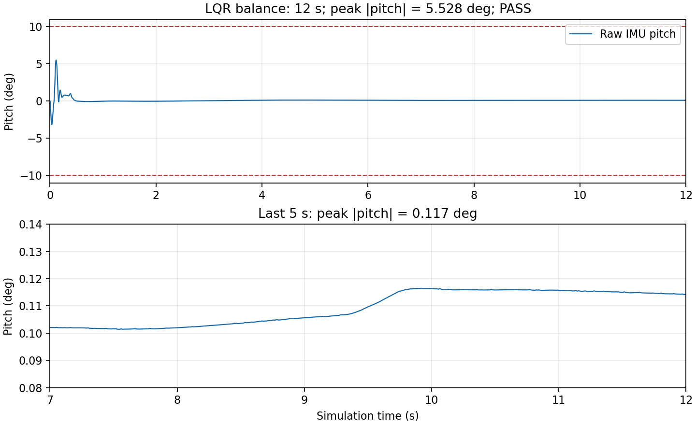

# ROS 2 轮腿控制器作业提交

本包对应教程 §5.8 的提交物，使用 `ament_python`。仓库：
[QH7777777/training](https://github.com/QH7777777/training)。
包位置：`02-ros2-wheelleg/Tutorial/ros2_ws/src/wheel_leg_controller/`。

## 提交物与演示链接

| §5.8 要求 | 提交内容 |
| --- | --- |
| 可构建的新控制包 | 本目录的源码、`package.xml`、`setup.py`、测试及复现脚本 |
| 控制结构、K/参数来源、实测平衡时长与 pitch 曲线 | 本 README、下方曲线、[原始 pitch CSV](docs/balance_pitch.csv)、[指标 JSON](docs/balance_metrics.json) |
| 10–20 秒录屏，或三话题 bag | [12 秒平衡 bag 下载](https://github.com/QH7777777/training/releases/download/wheel-leg-assignment-2026-11-11/balance-bag-12s.tar.gz) |
| 用户提供的本地录屏 | [原始演示录屏 WebM](https://github.com/QH7777777/training/releases/download/wheel-leg-assignment-2026-11-11/wheel-leg-demo.webm) |

[全部附件与发布说明](https://github.com/QH7777777/training/releases/tag/wheel-leg-assignment-2026-11-11)。
录屏来自用户本地 Videos，约 9.7 秒，未延长或修改；因此第 3 项以另行实测的 12 秒 bag 为正式证据。
录像、bag 和完整运行日志作为 Release 附件发布，不纳入 Git 历史。
附件校验值见 [SHA256SUMS](docs/SHA256SUMS)。

## 构建与启动

环境为 ROS 2 Humble、Python 3.10、课程 `rm_ros2` conda 环境，需安装课程仿真所需的 MuJoCo、NumPy。
以下假设仓库克隆在 `~/ros_tutorial/training`，其他位置只需替换 `cd` 路径。

```bash
conda activate rm_ros2
source /opt/ros/humble/setup.bash
cd ~/ros_tutorial/training/02-ros2-wheelleg/Tutorial/ros2_ws
colcon build --symlink-install --packages-up-to wheel_leg_controller wheel_leg_sim
source install/setup.bash
```

每个新终端都先激活环境、source ROS 和工作区。先停止旧仿真、旧控制器、
`wheel_leg_bridge` 及手动 `/actuator_cmd` 发布者，再分别启动：

```bash
# 终端 A：课程原始仿真
ros2 run wheel_leg_sim wheel_leg_sim --ros-args -p realtime:=true
```

```bash
# 终端 B：控制器，默认原地平衡
ros2 run wheel_leg_controller wheel_leg_controller --ros-args \
  -p mode:=lqr -p target_length:=0.10
```

```bash
# 终端 C：需要行驶时持续发布速度，默认斜板测试使用 0.2 m/s
ros2 topic pub -r 20 /cmd_vel geometry_msgs/msg/Twist '{linear: {x: 0.2}}'
```

停止发布后 1 秒未收到新指令，控制器将目标速度归零；也可显式发送零速度。
`max_steps=0` 默认持续运行，Ctrl+C 结束。倒下后重启仿真恢复初始姿态再测试。

## 控制结构与接口

MuJoCo 仿真节点和控制器分别运行，通过 ROS 话题交换数据；冻结的 `wheel_leg_sim` 未修改。
控制器不导入 MuJoCo、不访问仿真模型，也不搬运原工程的完整主循环。

| 方向 | 相对话题名 | 类型与用途 |
| --- | --- | --- |
| 输入 | `imu` | `sensor_msgs/msg/Imu`，姿态四元数和角速度 |
| 输入 | `joint_states` | `sensor_msgs/msg/JointState`，六关节角度与角速度 |
| 输入 | `cmd_vel` | `geometry_msgs/msg/Twist`，仅使用 `linear.x` |
| 输出 | `actuator_cmd` | `rm_msgs/msg/WheelLegCmd`，六电机力矩 |
| 输出 | `controller/telemetry` | `std_msgs/msg/Float64MultiArray`，测量、参考值和恢复状态 |

传感器按相同 `header.stamp` 配对，按关节名取值，每组完整状态只发送一条力矩指令。
关节名为 `right1,right2,left1,left2,rightwheel,leftwheel`。
四元数归一化后解算姿态，pitch/gyro 的符号与课程原控制器一致。控制步长固定为 0.002 秒。

LQR 模式的解算顺序：

1. 五连杆正运动学从腿角和 IMU 求两侧 `L_0`、`theta` 及角速度。
2. 轮半径为 0.06 m，前向轮速为右轮 `-velocity*0.06`、左轮 `velocity*0.06`。
3. 用共模轮编码器更新 LQR 状态，按当前腿长计算三次多项式 K。
4. 六维误差为 `[theta,d_theta,x_b-x_b_set,v_b-v_set,pitch,gyro_pitch]`，
   K 的偶数项生成轮力矩、奇数项生成腿部虚拟摆动力矩 `Tp`。
5. Roll 控制分配两侧腿长，腿长离散 PD 和支撑前馈生成轴向力 `F0`。
6. VMC 把 `F0,Tp` 映射为四个腿力矩，加上两个轮力矩，通过话题发送。

位置参考只在首次初始化及行驶时跟随当前位置，停车后冻结，保留位置反馈。
目标速度的加速/减速限制分别为 0.8/1.4 m/s²。
轮力矩限制 ±2 N·m；复用 VMC 内部的腿力矩限制 ±1.8 N·m，低于接口允许的 ±6 N·m。

运动时额外加入有界的共模速度误差积分辅助，增益为 3，辅助量范围 0–1 N·m，
补足平地 LQR 在坡面上的持续牵引；停车或换向清零，俯仰超过 0.25 rad 时逐步释放。
稳定 0.5 秒后启用扰动恢复：俯仰超过 8° 或俯仰角速度超过 0.85 rad/s 时，
速度目标降至 80%；回到 5°/0.6 rad/s 内连续 0.3 秒后退出，冷却 0.5 秒。

## K 与参数来源

| 内容 | 来源或设置 |
| --- | --- |
| 五连杆几何和 VMC | [课程 vmc_cal.py](../../../../Wheel_Leg/LQR_VMC/vmc_cal.py)，原样复制 |
| LQR K 多项式系数及状态定义 | [课程 lqr_update.py](../../../../Wheel_Leg/LQR_VMC/lqr_update.py)，原样复制，未重新设计 K |
| Roll 腿长分配 | [课程 roll_leg_control.py](../../../../Wheel_Leg/LQR_VMC/roll_leg_control.py)，原样复制 |
| 状态符号、力矩映射、离散腿长 PD | [课程 robot_control_main.py](../../../../Wheel_Leg/LQR_VMC/robot_control_main.py) |
| LQR 腿长控制 | `700*error + 5*(error-last_error)`，支撑前馈 `4/cos(theta)` |
| 阶段 2/3 轮速 PI | Kp=0.3、Ki=1.5，误差换算为 rad/s，含积分抗饱和 |
| 阶段 3 腿长 PID | Kp=700、Ki=300、Kd=5，连续时间微分，VMC 力矩映射限制积分 |
| 速度斜坡、上坡辅助、扰动恢复 | 独立控制器的集成与调试参数，按以上实测工况验证 |

三份课程算法文件保持原样，包括原版差分量恒为零的行为。
LQR 使用原版离散腿长 PD；`vmc` 模式使用另一套连续 PID，二者没有混用。
三份原始参考算法保留原格式，风格检查覆盖新增控制器、脚本与测试。

## 实测平衡时长与 pitch 曲线

2026-11-11 使用本次提交的控制算法，独立 ROS 仿真、控制器和录包进程，
目标腿长 0.10 m，速度指令为零，原始课程场景，实时运行 6000 个控制步。

| 指标 | 实测值 | 验收 |
| --- | ---: | --- |
| 仿真平衡时长 | 12.000 s | ≥5 s |
| 连续 `abs(pitch)<10°` 时长 | 12.000 s | 通过 |
| 全程最大绝对 pitch | 5.528° | <10° |
| 最后 5 秒最大绝对 pitch | 0.117° | 稳定 |
| 最后 5 秒平均 pitch | 0.109° | 稳定 |
| 最后 5 秒编码器位置范围 | −0.0891 至 −0.0841 m | 无持续恒速漂移 |
| 最大腿/轮力矩 | 1.8 / 2.0 N·m | 在接口限幅内 |



图由 [原始 IMU CSV](docs/balance_pitch.csv) 绘制；[机器可读指标](docs/balance_metrics.json)。
图中采用原始 IMU 的 pitch 符号，与控制遥测内部取反的 pitch 不同；绝对值验收一致。
bag 包含 6001 条 IMU、6001 条关节状态和 6000 条执行器指令。
仿真时间跨度为 12 秒，`ros2 bag info` 显示墙钟录制跨度约 11.998 秒。

复现平衡测量并录制 bag，在已 source 的 `ros2_ws` 中执行：

```bash
python3 src/wheel_leg_controller/scripts/verify_stage4.py \
  --seconds 12 --output-dir stage4_validation
```

脚本使用独立命名空间，仅结束自己启动的进程。输出 pitch CSV、JSON 指标、日志和 bag。
输出目录中的 `balance_bag` 必须不存在，再次运行时更换目录名。

下载 Release 的 bag 后解压，可检查并回放到根话题名：

```bash
tar -xzf balance-bag-12s.tar.gz
ros2 bag info balance_bag
# 回放前先停止仿真和控制器，避免与录制话题冲突
ros2 bag play balance_bag --remap \
  /stage4_14049/imu:=/imu \
  /stage4_14049/joint_states:=/joint_states \
  /stage4_14049/actuator_cmd:=/actuator_cmd
```

## 各阶段结果与适用范围

| 阶段 | 已有实测 |
| --- | --- |
| 1 通信链路 | 固定力矩、传感器到指令配对和独立节点启动 |
| 2 轮速 PI | 目标 0.5 m/s，稳态平均绝对相对误差约 14%；瞬时误差峰值约 34%，逐点 <20% 尚未达到 |
| 3 VMC | 目标腿长 0.12 m，最后 3 秒两侧最大误差约 0.25 mm，小于 ±5 mm |
| 4 LQR 必做 | 本次 12 秒平衡，全程最大 pitch 5.528° |
| 5 平地行驶 | 0.3 m/s 指令，9.998 秒轮位移 3.471 m，最大 pitch 5.906° |
| 默认五块斜板 | 0.2 m/s、22 秒通过并继续行走，最大 pitch 30.33°，冲击明显 |
| 连续 9° 坡面 + 6 cm 下台阶 | 0.2 m/s、24 秒最大 pitch 6.47°；落地后 22–24 秒平均右轮速约 0.221 m/s |

阶段 5 指标见 [docs/stage5](docs/stage5)，来自前次当前控制算法的 ROS 双节点测试。
JSON 中的绝对场景路径是原测试机上的记录；复现请使用包内场景的路径。
轮位移在空转时不等于机身位移；前次直接 MuJoCo 诊断另核实默认斜板 30 秒时机身 x≈6.34 m，
连续坡面 30 秒时 x≈5.86 m。录屏仅作为演示，不用于推算 pitch 指标。

提供 [平地](scenes/flat/robot.xml) 和 [连续坡面/6 cm 下台阶](scenes/ramp_drop/robot.xml)
可选场景，复制课程机器人本体，仅修改环境地形；课程原始仿真包未改。
在工作区中复现加分项：

```bash
python3 src/wheel_leg_controller/scripts/verify_stage23.py \
  --mode lqr --speed 0.3 --length 0.10 --steps 5000 \
  --tag flat_3m --output-dir stage5_validation --param cmd_timeout:=60.0 \
  --sim-param "robot_xml:=$PWD/src/wheel_leg_controller/scenes/flat/robot.xml"

python3 src/wheel_leg_controller/scripts/verify_stage23.py \
  --mode lqr --speed 0.2 --length 0.10 --steps 12000 \
  --tag ramp_drop --output-dir stage5_validation --param cmd_timeout:=60.0 \
  --sim-param "robot_xml:=$PWD/src/wheel_leg_controller/scenes/ramp_drop/robot.xml"
```

默认斜板有板间接触突变，不能称为平稳越障。未实现转向、手柄遥控或倒地自动起立；
更大落差、其他速度和腿长需要另行验收。

## 参数、遥测与测试

`mode` 可选 `link_test`、`wheel_pi`、`vmc`、`lqr`，默认 `lqr`。
`target_length` 范围 0.10–0.14 m；`cmd_timeout` 默认 1 秒；`max_steps` 默认 0。
PI/PID 参数可在启动时通过 `wheel_kp,wheel_ki,leg_kp,leg_ki,leg_kd` 设置。

`controller/telemetry.data` 顺序为：

```text
time_s,target_v,target_L,v_right,v_left,L_right,L_left,theta_right,theta_left,pitch,
position,position_ref,velocity_setpoint,roll,pitch_rate,recovery_active
```

时间为秒、速度为 m/s、长度/位置为 m、角度为 rad、角速度为 rad/s。
最后六项仅存在于 LQR 模式。可用 `ros2 topic echo /controller/telemetry` 查看。

环境补齐风格检查依赖后测试（隔离 conda 中不兼容的 pytest 自动插件）：

```bash
python3 -m pip install 'flake8<5' 'pydocstyle<7'
PYTEST_DISABLE_PLUGIN_AUTOLOAD=1 colcon test --packages-select wheel_leg_controller
colcon test-result --verbose
```

算法测试覆盖电机符号、PID 抗饱和、VMC 对称性、位置参考冻结、LQR 状态更新、
冲击恢复、上坡辅助的限幅及停止/换向清零。生成模板的版权检查仍为 skip，
三份课程算法的格式检查不重写原文件；其余新增 Python 代码执行 flake8/PEP257 检查。
